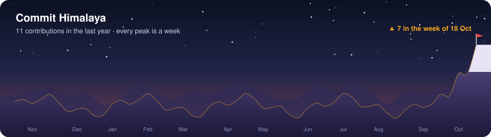

<p align="center">
  
</p>

<p align="center">
  
  <a href="https://github.com/Hsegoy21?tab=followers"></a>
</p>

<table>
<tr>
<td width="62%" valign="top">

### 🏕️ Base Camp

**नमस्ते!** I'm Yogesh, a network and cybersecurity enthusiast from Nepal 🇳🇵.

I like knowing how networks work, how they break, and how to make them harder to break. I spend my time on routing and switching, traffic analysis, hardening systems, and scripting the repetitive parts in Python and Bash.

</td>
<td width="38%" valign="top">

### 🧭 Trail Card

```yaml
focus:     network + security
basecamp:  Nepal (UTC+5:45)
listening: 0.0.0.0:443
fuel:      dal bhat + chiya
motto:     trust, but verify
```

</td>
</tr>
</table>

### 🎒 Gear

<p>
  
  
  
  
  
  
  
  
  
  
  
</p>

<sub>Core ground: TCP/IP · routing &amp; switching · VLANs · firewalls &amp; VPNs · IDS/IPS · vulnerability assessment · system hardening</sub>

### ⛰️ Trail Log

<p align="center">
  
  <br>
  <sub>Every peak is a week of commits. Redrawn daily by a GitHub Action in this repo, so no third-party card service.</sub>
</p>

<p align="center">
  
</p>

### 🏔️ Summit Goals

- [x] Set up base camp (this profile)
- [ ] Build a home lab: segmented network, firewall, SIEM
- [ ] Earn a networking and a security certification
- [ ] Solve CTFs regularly on TryHackMe / Hack The Box
- [ ] Publish write-ups and open-source security tools

### 📮 Send a Postcard

<p>
  <a href="https://github.com/Hsegoy21"></a>
  <!-- Add more postcards, e.g.
  <a href="https://tryhackme.com/p/YOUR-ID"></a>
  <a href="https://app.hackthebox.com/profile/YOUR-ID"></a>
  <a href="https://linkedin.com/in/YOUR-ID"></a>
  <a href="mailto:YOU@example.com"></a>
  -->
</p>

<p align="center">
  
</p>
